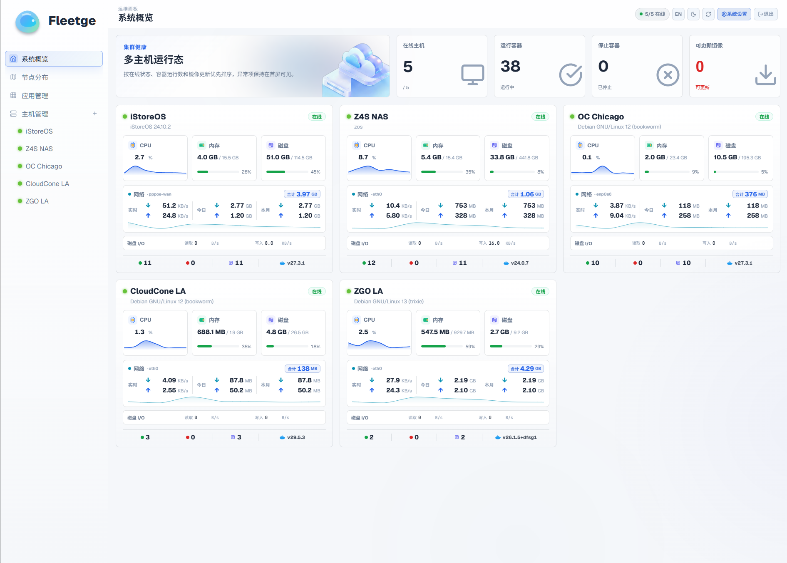
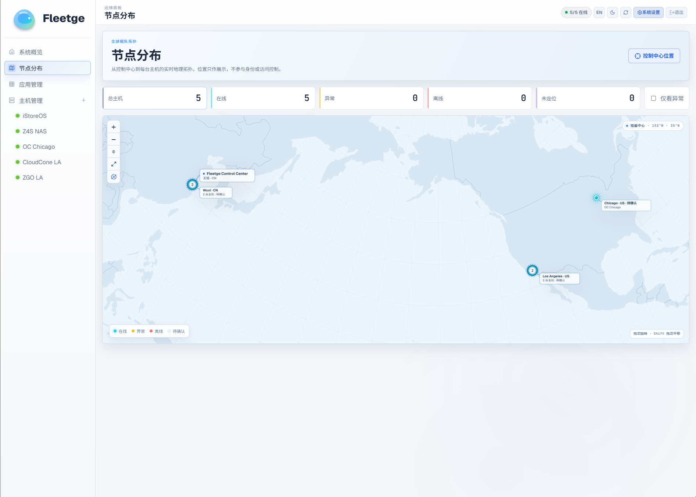

> [!IMPORTANT]
> **Vibe Coding Disclaimer**
>
> This repository is a personal project built with AI assistance in a **vibe coding** style: requirements are described in natural language and the code is generated and modified by AI, while the author is responsible for product ideas, hands-on validation, and direction. The author is not a professional developer and has no systematic code-audit capability. The code is provided as is; please review, test, and accept the associated risks yourself before using, deploying, or building on it.

<div align="center">


# Fleetge Docker Fleet Console

<a href="README.md"></a>


</div>

---

> **Fleetge** is a lightweight, real-time, self-hosted operations console for multi-host Docker environments.
>
> By deploying `fleetge-agent` on managed nodes, it brings host metrics, container status, Compose Stack lifecycle actions, image update checks, subscription traffic, and audit logs from different servers into one modern web interface.

Fleetge's product shape and parts of its interaction model are inspired by and acknowledge [Dockge](https://github.com/louislam/dockge). This project is not a Dockge fork; it is an independent implementation for multi-host Docker operations.

## Preview

<div align="center">
  
</div>

| Fleet Map | App Launchpad |
| :---: | :---: |
|  |  |

| Host Console | Image Updates |
| :---: | :---: |
|  |  |

## Capabilities

| Capability | Description |
| :--- | :--- |
| Multi-host dashboard | View online status, CPU, memory, disk, network throughput, and container counts across all managed hosts, with host logos. |
| Real-time metrics | Stream host metrics over SSE with fixed-height host cards and trend sparklines. |
| Traffic and subscription billing | Track real-time WAN rates and cumulative traffic for today and custom billing cycles (e.g. starting on the 15th). Supports traffic quotas (`GB`/`TB`/`GiB`/`TiB`; upload, download, both, or the larger of the two), expiry dates, and renewal records. See [docs/host-billing.md](docs/host-billing.md). |
| Fleet Map | Visualize geographic distribution, online status, and telemetry of all managed nodes on an interactive global map. |
| App Launchpad | Aggregate service entry points by host or custom group, filter by runtime/update status, and open external app URLs quickly. |
| Compose Stack management | Start, stop, restart, update, and delete stacks remotely with live terminal output. Updates to Fleetge/Agent itself and to ingress stacks run as detached background jobs that continue if the connection drops. |
| Built-in Compose editor | Create, edit, and deploy Compose files from the web UI with a Monaco editor, and convert `docker run` commands into Compose drafts. |
| Image update detection and auto-update | Compare local images with remote registry digests and classify up-to-date, updatable, pending, needs-auth, rate-limited, and failed checks. Checks run in the background without blocking structure refresh, and each stack can opt in to automatic upgrades. |
| Host OS update checks | Detect package updates from agent hosts, including apt/yum-based systems. |
| One-command enrollment and customization | Generate a one-line Agent install command in Settings (optionally with a Caddy reverse proxy). Manage host logos (built-in brands, image URL, or upload), `global.env`, stack icon matching rules, app profiles, custom groups, and external URLs. |
| Themes and languages | Built-in Simplified Chinese / English UI, dark / light themes, and adjustable liquid-pour theme transition presets (off / crisp / standard / lush). |
| Security and auditing | In production mode (`FLEETGE_ENV=production`) the app refuses to start with default secrets. Credentials are encrypted with Fernet, admin passwords are verified with PBKDF2-HMAC-SHA256, failed logins are rate-limited, and critical write actions are recorded in audit logs. |

## Stack Auto-Update

Turn on "Auto upgrade" in a stack's detail page; it is off by default. Once enabled, the next background or manual "Check for updates" that confirms a newer image for the current tag triggers the existing upgrade flow automatically; closing the web page does not interrupt it. Only healthy, manageable Compose stacks are handled, one at a time per host. The stack that runs Fleetge/Agent itself does not offer auto-update.

A manual upgrade pulls the running services of the stack directly and does not depend on cached check results. An automatic upgrade only handles services with a confirmed newer image in the cache; bulk upgrades additionally accept the "pending" state. When a task starts, it freezes the service list, platform, target digest, and check time. Services with no update or a failed check are skipped with the reason shown, and a local-only image never blocks other services in the same stack. Each service runs `pull <service>` and `up -d --no-deps --pull never <service>` separately, so services without updates are not recreated. After a service fails or stays unconfirmed, the remaining services and stacks continue; results are recorded per service, and a mix of success and failure/pending is shown as "partial success".

A clear single-service `pull` failure is retried once after 10 seconds; an `up` failure is neither retried nor rolled back. Final verification reads local Docker information only: it confirms the running container uses the image just pulled, matches the target digest and platform, and waits for any existing health check to pass, without querying the registry again. After successful verification the update badge for that image is cleared. If the tag changed after the check so the digest differs, the result is shown as "to be confirmed by the next scheduled check" instead of falsely reporting success. Later scheduled checks or a manual "Check for updates" keep refreshing registry data.

When an automatic update ends in failure, partial success, or an unconfirmed result, the stack's switch is turned off and the reason plus audit record are kept; re-enable it manually after fixing the issue. Turning the switch off does not interrupt services already started, but cancels services not yet started and the second attempt. Old Agents that lack target-image and execution evidence report "pending" and need to be upgraded together. A backend restart never replays update commands.

### Notify Hub Alerts

Notify Hub in system settings is optional: enter the service URL, a dedicated API Client key, and the Notify Hub recipient ID. The client must allow the `fleetge.stack.auto_update` event and that recipient, and have media permission enabled. The API key is stored encrypted; leave it blank to keep it, or clear it explicitly to disable notifications. Success, failure, and unconfirmed results are submitted via `POST /api/v1/events`; `202` means Notify Hub has taken over durable delivery, not that WeCom has delivered the message. Temporary submission failures are re-sent with the same event key for up to 24 hours, and results from before configuration are not back-filled. Notification failures never change the container update result.

Notifications use illustrated cards by default: the Fleetge mark, the event type, and a representative icon form the cover. Container updates use a teal-slate background, expiry reminders use warm gold, and traffic alerts use pale violet. Container updates use one configured icon of the stack; expiry and traffic alerts read the host's `logo` before the first send and fall back to a generic icon when it is unset or unavailable. The cover is stored with the message, so retries are unaffected by later logo changes, and a short text result is still sent if the cover upload fails. The full update log stays in Fleetge.

## Architecture

```text
Browser
  |
  v
Fleetge Dashboard
  |-- SQLite / PostgreSQL
  |-- hosts.yaml
  |
  +-- fleetge-agent on Host A -- Docker Engine / Compose stacks
  +-- fleetge-agent on Host B -- Docker Engine / Compose stacks
  +-- fleetge-agent on Host C -- Docker Engine / Compose stacks
```

Each refresh round the Dashboard fetches host structure and image evidence in one go through `/api/agent/snapshot` and `/api/agent/image-evidence`, with GZip compression, which greatly reduces round trips over WAN links; older Agents automatically fall back to per-endpoint requests. The `fleetge-agent` image is Alpine-based and published for `linux/amd64` and `linux/arm64`.

## Quick Start

### 1. Prepare the data directory

```bash
mkdir -p data
cp hosts.yaml.example data/hosts.yaml
```

Edit `data/hosts.yaml` (you can also add hosts later from the web UI via one-command enrollment):

```yaml
hosts:
  - host_id: node-1
    display_name: Production Node 01
    sort_order: 1
    enabled: true
    agent:
      url: http://<agent-host>:8080/<optional-secret-path>
      token: "replace-with-a-long-random-token"
```

### 2. Generate secrets

```bash
# JWT signing secret
python -c "import secrets; print(secrets.token_hex(32))"

# Fernet key for credential encryption
python -c "from cryptography.fernet import Fernet; print(Fernet.generate_key().decode())"
```

### 3. Create `.env`

You can copy `.env.example` and fill it in:

```env
FLEETGE_ENV=production
JWT_SECRET=replace_with_jwt_secret
CREDENTIALS_KEY=replace_with_fernet_key
ADMIN_PASSWORD=replace_with_strong_admin_password

DATABASE_URL=sqlite:////app/data/dashboard-local.db
HOST_CONFIG_PATH=/app/data/hosts.yaml

METRICS_STREAM_INTERVAL=2
DOCKER_POLL_INTERVAL=10
BACKGROUND_STRUCTURE_REFRESH_INTERVAL=3600
UPDATE_CHECK_INTERVAL=43200
LOG_LEVEL=info
```

With `FLEETGE_ENV=production`, startup is refused if the default `JWT_SECRET`, the default `CREDENTIALS_KEY`, or `ADMIN_PASSWORD=admin` is in use. `ADMIN_PASSWORD` accepts plain text or a `pbkdf2_sha256$...` hash.

### 4. Start the dashboard

```yaml
services:
  fleetge:
    image: ghcr.io/virgooooox/fleetge:latest
    container_name: fleetge
    restart: unless-stopped
    env_file: .env
    volumes:
      - ./data:/app/data
    ports:
      - "80:8000"
```

```bash
docker compose up -d
```

Open `http://<server-ip>` in your browser. The default admin username is `admin`, and the password is the `ADMIN_PASSWORD` value from `.env`.

## Agent Deployment

### Option 1: One-command enrollment (recommended)

After logging in to the Dashboard, create an enrollment invite under "Settings → Hosts", then run the generated one-line install command on the target host. It deploys the Agent (optionally together with a Caddy reverse proxy) and adds the host to the list. The images used can be configured with `ENROLLMENT_AGENT_IMAGE` and `ENROLLMENT_PROXY_IMAGE`.

### Option 2: Manual Docker Compose

Deploy `fleetge-agent` on each managed Docker host:

```yaml
services:
  agent:
    image: ghcr.io/virgooooox/fleetge-agent:latest
    container_name: fleetge-agent
    restart: unless-stopped
    network_mode: host
    environment:
      AGENT_TOKEN: replace-with-a-long-random-token
      AGENT_SECRET_PATH: /replace-with-random-path
      AGENT_REQUIRE_TOKEN: "true"
      AGENT_PUBLIC_HEALTH: "false"
      AGENT_ENABLE_WRITE: "true"
      AGENT_ENABLE_DELETE: "true"
      AGENT_ENABLE_GLOBAL_ENV: "true"
      AGENT_ENABLE_PRUNE: "false"
      AGENT_ENABLE_SELF_UPDATE: "true"
      STACKS_BASE_DIR: /opt/stacks
      PORT: "8080"
      AGENT_BIND_HOST: 0.0.0.0
      DISK_PATHS: /
      METRICS_ACTIVE_INTERVAL: "2"
      METRICS_IDLE_TIMEOUT: "15"
      TRAFFIC_IDLE_INTERVAL: "60"
      TRAFFIC_INTERFACES: auto
      AGENT_STATE_DIR: /opt/stacks/.fleetge
      AGENT_LOG_LEVEL: INFO
    volumes:
      - /var/run/docker.sock:/var/run/docker.sock
      - /opt/stacks:/opt/stacks
```

```bash
docker compose up -d
```

If `AGENT_SECRET_PATH` is set, include it in the dashboard-side `agent.url`, for example `http://192.168.1.10:8080/replace-with-random-path`.

## Configuration

### Dashboard

| Variable | Default | Description |
| :--- | :--- | :--- |
| `FLEETGE_ENV` | `development` | Runtime environment. `production` refuses to start with default secrets; the bundled `docker-compose.yml` defaults to `production`. |
| `JWT_SECRET` | Required | JWT signing secret. A 64-character hex random string is recommended. |
| `CREDENTIALS_KEY` | Required | Fernet symmetric key for encrypting remote credentials in the database. |
| `ADMIN_USERNAME` | `admin` | Administrator username. |
| `ADMIN_PASSWORD` | Required | Administrator login password; plain text or a `pbkdf2_sha256$...` hash. |
| `DATABASE_URL` | `sqlite:////app/data/dashboard-local.db` | SQLAlchemy database URI. SQLite and PostgreSQL are supported. |
| `HOST_CONFIG_PATH` | `/app/data/hosts.yaml` | Path to the host configuration file. |
| `METRICS_STREAM_INTERVAL` | `2` | Shared SSE metrics broadcast interval in seconds. Valid range: `0.5` to `10.0`. |
| `DOCKER_POLL_INTERVAL` | `10` | Docker container and stack structure refresh interval while clients are connected, in seconds. Valid range: `5` to `300`. |
| `BACKGROUND_STRUCTURE_REFRESH_INTERVAL` | `3600` | Background structure refresh interval while no clients are connected, in seconds. Valid range: `60` to `86400`. |
| `UPDATE_CHECK_INTERVAL` | `43200` | System and image update check cache interval in seconds. Valid range: `3600` to `172800`. |
| `JWT_EXPIRE_HOURS` | `24` | Login session lifetime in hours. Valid range: `1` to `720`. |
| `ENROLLMENT_AGENT_IMAGE` | `ghcr.io/virgooooox/fleetge-agent:latest` | Agent image used by one-command enrollment scripts; also editable in system settings. |
| `ENROLLMENT_PROXY_IMAGE` | `caddy:2-alpine` | Reverse-proxy image used by one-command enrollment scripts; also editable in system settings. |
| `CORS_ORIGINS` | Empty | Allowed CORS origins, comma separated. Empty means same-origin only. |
| `TRUSTED_PROXY_CIDRS` | Empty | Reverse-proxy CIDRs allowed to provide the enrollment callback source IP. |
| `LOG_LEVEL` | `info` | Log level: `debug`, `info`, `warning`, or `error`. |

### Agent

| Variable | Default | Description |
| :--- | :--- | :--- |
| `AGENT_TOKEN` | Required | Agent access token. At least 32 characters are required by default. |
| `AGENT_SECRET_PATH` | Empty | Optional URL prefix. When set, all agent routes require this path. |
| `AGENT_TOKEN_MIN_LENGTH` | `32` | Minimum token length. |
| `AGENT_REQUIRE_TOKEN` | `true` | Whether the agent must require a token. |
| `AGENT_PUBLIC_HEALTH` | `false` | Whether health endpoints are publicly accessible. |
| `AGENT_ENABLE_WRITE` | `true` | Whether stack write operations are allowed. |
| `AGENT_ENABLE_DELETE` | `true` | Whether stack deletion is allowed. |
| `AGENT_ENABLE_GLOBAL_ENV` | `true` | Whether writing `global.env` is allowed. |
| `AGENT_ENABLE_PRUNE` | `false` | Whether Docker prune is allowed. |
| `AGENT_ENABLE_SELF_UPDATE` | `true` | Whether agent self-update related operations are allowed. |
| `STACKS_BASE_DIR` | `/opt/stacks` | Compose stack directory on the managed host. |
| `PORT` | `8080` | Agent listen port; with Host networking it must not collide with an existing listener. |
| `AGENT_BIND_HOST` | `0.0.0.0` | Agent bind address; use `127.0.0.1` behind a Host reverse proxy. |
| `DISK_PATHS` | `/` | Disk mount points to monitor, comma separated. |
| `METRICS_ACTIVE_INTERVAL` | `2` | Host telemetry and live traffic interval while Metrics is requested. |
| `METRICS_IDLE_TIMEOUT` | `15` | Seconds after the final Metrics request before telemetry sleeps. |
| `TRAFFIC_IDLE_INTERVAL` | `60` | WAN traffic accounting interval while telemetry sleeps. |
| `TRAFFIC_INTERFACES` | `auto` | `auto` selects default-route interfaces; a comma-separated list overrides it. |
| `AGENT_STATE_DIR` | `/opt/stacks/.fleetge` | Persistent directory for the five-minute traffic ledger. |
| `DOCKER_HOST` | Empty | Docker daemon address; when empty, the Unix socket or Windows `127.0.0.1:2375` is auto-detected. |
| `COLLECT_INTERVAL` | Empty | Deprecated compatibility alias used only when `METRICS_ACTIVE_INTERVAL` is unset. |
| `AGENT_LOG_LEVEL` | `INFO` | Agent log level. |

## Build From Source

```bash
mkdir -p data
cp hosts.yaml.example data/hosts.yaml
cp .env.example .env   # and fill in the secrets
docker compose up -d --build
```

## Security Notes

- Keep `FLEETGE_ENV=production` in production, and use strong values for `ADMIN_PASSWORD` and `AGENT_TOKEN`.
- Do not commit production `.env`, `data/hosts.yaml`, or database files.
- Expose agents only to trusted networks, or place them behind a reverse proxy/firewall.
- Be careful when enabling high-risk capabilities such as `AGENT_ENABLE_PRUNE` and `AGENT_ENABLE_DELETE`.
- Back up the `data` directory regularly. It contains host configuration, database state, and runtime data.

## Acknowledgements

- [Dockge](https://github.com/louislam/dockge): Fleetge's product shape and parts of its interaction model are inspired by Dockge.
- Docker, Compose, FastAPI, Vue, and the wider open-source ecosystem.

## License

[MIT License](LICENSE)
